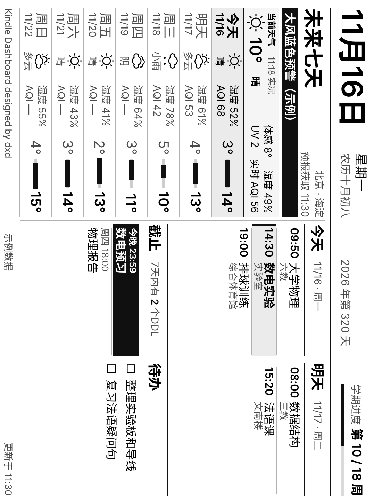

# Kindle Dashboard

把日期、学期进度、天气、日程、截止和待办排成一张 **1077 × 1448 灰度 PNG**，适合在 Kindle 上显示。



| 你想做什么 | 从哪里开始 |
| --- | --- |
| 在电脑上做出上面这张图 | [生成第一张图](#1-生成第一张图) |
| 换成自己的课表、待办和天气 | [换成自己的数据](#2-换成自己的数据) |
| 在手机上切换日程、筛选任务 | [手机版看板](#手机版看板) |
| 让 Kindle 定时显示看板 | [发布并接入 Kindle](#3-发布并接入-kindle) |

## 1. 生成第一张图

下面的命令适用于 **Ubuntu 24.04** 的终端。Windows 用户可以在 Ubuntu WSL 中执行同一组命令。使用其他系统时，请先准备 Git、Python 3.12（含 `venv`）、CMake 和支持 C++17 的编译器。

### 安装依赖并下载项目

```bash
sudo apt update
sudo apt install -y git python3 python3-venv cmake build-essential

git clone https://github.com/dxd1202/Kindle-Dashboard.git
cd Kindle-Dashboard
python3 -m venv .venv
.venv/bin/python -m pip install -r requirements.txt
```

### 运行示例

```bash
.venv/bin/python main.py --demo --output build/demo.png
```

首次运行会编译 C++ 渲染器。终端显示「看板生成成功」后，在文件管理器里打开 `build/demo.png`，应该能看到和本页相同的示例。字体随仓库提供，示例运行时无需天气 API Key、GitHub Pages 或 Kindle。

## 2. 换成自己的数据

### 复制一份可编辑的示例

下面的命令从仓库根目录执行。已有 `dashboard.local.json` 的读者可以直接编辑现有配置，并把 `calendar` 和 `tasks_file` 改成自己的文件路径。

```bash
mkdir -p local-data
test -e local-data/calendar.ics || cp examples/calendar.ics local-data/calendar.ics
test -e local-data/tasks.json || cp examples/tasks.json local-data/tasks.json

if [ ! -e dashboard.local.json ]; then
  cat > dashboard.local.json <<'JSON'
{
  "semester": {"start": "2026-09-14", "weeks": 18},
  "calendar": "local-data/calendar.ics",
  "tasks_file": "local-data/tasks.json"
}
JSON
fi

.venv/bin/python main.py --offline --output build/local-preview.png
```

打开 `build/local-preview.png`。这次显示的是当天日期和本地文件里的日程、截止与待办，天气栏显示离线状态。示例日历含每天重复的「阅读与笔记」，从 2026 年 9 月 14 日起会出现在「今天」和「明天」。`local-data/` 和 `dashboard.local.json` 都由 Git 忽略。

### 编辑日程、截止和待办

```bash
.venv/bin/python main.py --edit-tasks
```

1. 打开终端显示的网址，进入「日程」页，给今天或明天新增一条日程。编辑重复日程时，只会修改选中的那一次。
2. 进入「任务」页，新建一条没有截止时间的任务，再建一条截止时间设为明天的任务。编辑器使用北京时间，操作会立即保存。
3. 回到终端按 `Ctrl+C`，再运行一次 `.venv/bin/python main.py --offline --output build/local-preview.png`。重新打开图片，检查刚添加的内容。

已有课表可以从日历应用导出为 `.ics`，放进 `local-data/`，再将 `calendar` 指向它。使用学期进度时，把 `semester.start` 改成开学日期（`YYYY-MM-DD`），`semester.weeks` 改成总教学周数。需要纯天气版图片时，在出图命令末尾加上 `--hide-timetable`。

### 获取实时数据

```bash
.venv/bin/python main.py
```

默认输出 `build/output.png`，天气地点是北京海淀。换城市时，编辑 [config.py](kindle_dashboard/config.py) 中的 `WEATHER_LOCATION`，填入城市名、区名、纬度和经度。

默认使用 Open-Meteo 预报。需要和风天气的实况、空气质量和预警时，将 [.env.example](.env.example) 复制为 `.env`，取消 `WEATHER_HOST`、`WEATHER_KEY` 两行的注释并填写值，再运行同一条命令。`WEATHER_HOST` 填和风天气控制台给出的专属 API Host。`.env` 由 Git 忽略。

<details>
<summary>环境变量及优先级</summary>

| 设置 | 用法 |
| --- | --- |
| `WEATHER_HOST`、`WEATHER_KEY` | 两项均填写时启用和风天气。和风预报不可用时尝试 Open-Meteo。 |
| `ICS_DATA`、`ICS_FILE` | 依次优先使用内联 ICS、指定文件、`dashboard.local.json` 的 `calendar`、默认的 `timetable.local.ics`。使用 `ICS_DATA` 时，编辑器的日程页只读。 |
| `TASKS_FILE` | 优先于 `dashboard.local.json` 的 `tasks_file`，默认读取 `tasks.local.json`。 |
| `SEMESTER_START`、`SEMESTER_WEEKS` | `dashboard.local.json` 未配置 `semester` 时生效，默认总周数为 18。 |

普通出图和编辑器会读取 `.env`。`--offline` 读取本地 JSON 配置和已导出的环境变量，跳过 `.env` 与天气请求。`--demo` 使用内置示例。

</details>

## 3. 发布并接入 Kindle

1. **先准备图片地址。** 按 [GitHub Pages 发布指南](docs/pages.md) 配置自己的仓库，先发布离线示例。用无痕窗口打开部署地址末尾的 `/output.png`，看到图片后再接入设备。
2. **再准备 Kindle。** 设备需要越狱、安装 KUAL 并连上 Wi-Fi。先检查机型和固件版本，再按 [Kindle 安装指南](docs/kindle.md#设备准备) 复制设备端文件、填写图片地址并启动看板。项目曾在 Paperwhite 3 上运行，当前脚本的完整安装和退出流程待真机复测。
3. **最后换成自己的数据。** 在 GitHub Actions 中配置自己的日程、任务和学期参数。手动出图成功后，再按 [定时更新说明](docs/pages.md#定时更新) 设置定时发布。

GitHub Pages 上的图片可被公开访问。发布真实日程前，先用无痕窗口确认图片里展示的是你愿意公开的内容。

## 手机版看板

手机版分为待办、日程和天气三个页面。待办页可新增任务、编辑标题和截止时间、勾完成或恢复任务。部署后，在 Pages 站点地址末尾加 `/mobile/`。默认发布虚构的示例数据，可以直接体验编辑。连接真实任务清单后，手机会直接保存到 GitHub，下一次出图时同步到 Kindle。

在电脑上预览手机版示例：

```bash
.venv/bin/python main.py --demo --output build/site/output.png --web-output build/site/mobile
.venv/bin/python -m http.server 8000 --bind 127.0.0.1 --directory build/site
```

在同一台电脑的浏览器打开 `http://127.0.0.1:8000/mobile/`。手机使用部署后的 Pages 地址，打开后可从华为浏览器菜单选择「添加至桌面」。个人数据的发布方式见 [Pages 指南](docs/pages.md#手机版数据范围)。

## 常见问题

| 遇到的问题 | 先检查哪里 |
| --- | --- |
| 建虚拟环境时报 `ensurepip is not available` | Ubuntu 上安装 `python3-venv`，再执行 `python3 -m venv .venv`。 |
| 找不到 `cmake`，或 CMake 提示没有 C++ 编译器 | Ubuntu 上安装 `cmake` 和 `build-essential`。用 `cmake --version` 和 `c++ --version` 检查终端能否找到它们。 |
| 图还是示例日期，编辑也没反映出来 | 用 `--offline` 看本地文件。先检查 `dashboard.local.json` 的两个路径，再重新出图并打开这次写入的 PNG。 |
| 「今天」和「明天」没有对应日程 | 确认日程实际安排在北京时间的今天或明天，且 ICS 路径指向编辑器保存的文件。 |
| Pages 页面打开是 404 | 先确认 `deploy` 作业成功，再访问部署地址下的 `output.png`。部署内容只有图片和辅助文件。 |

## 开发与许可证

运行回归测试：

```bash
.venv/bin/python -m unittest discover -s tests -v
```

Python 入口是 `main.py`。`kindle_dashboard/` 负责采集和排版，`src/` 负责渲染 PNG，`kindle-device/` 存放设备脚本。项目代码采用 [MIT 许可证](LICENSE)，字体、图标和天气数据来源见 [第三方资源](THIRD_PARTY_NOTICES.md)。
